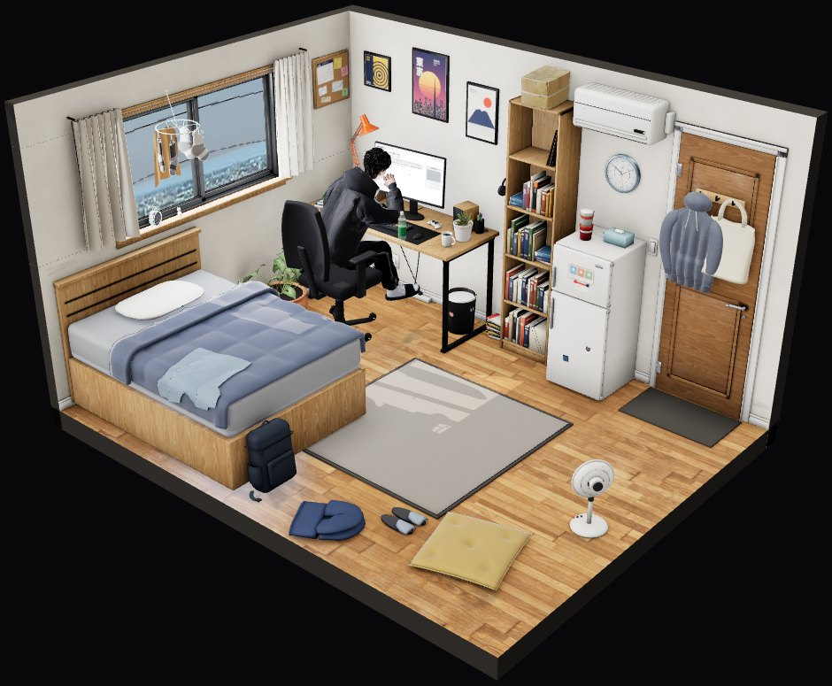
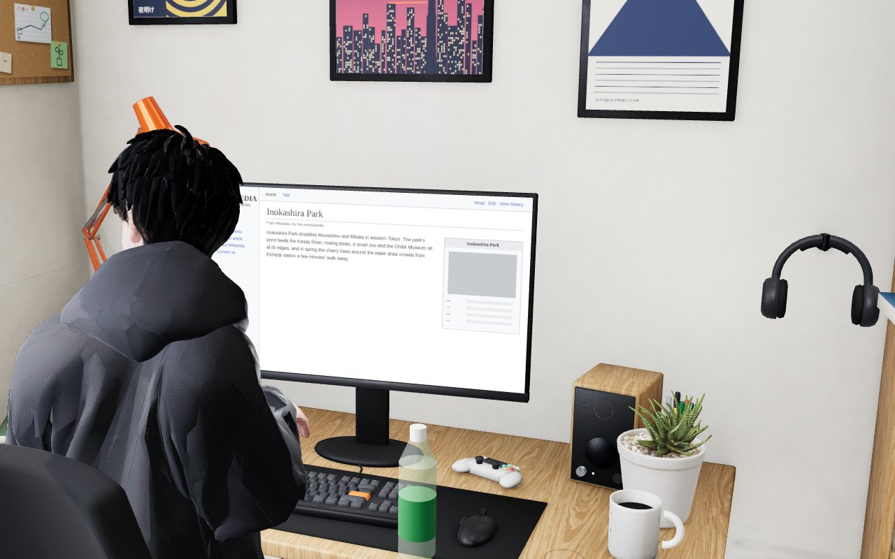
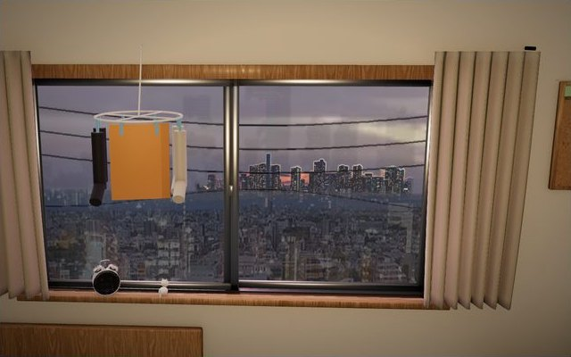
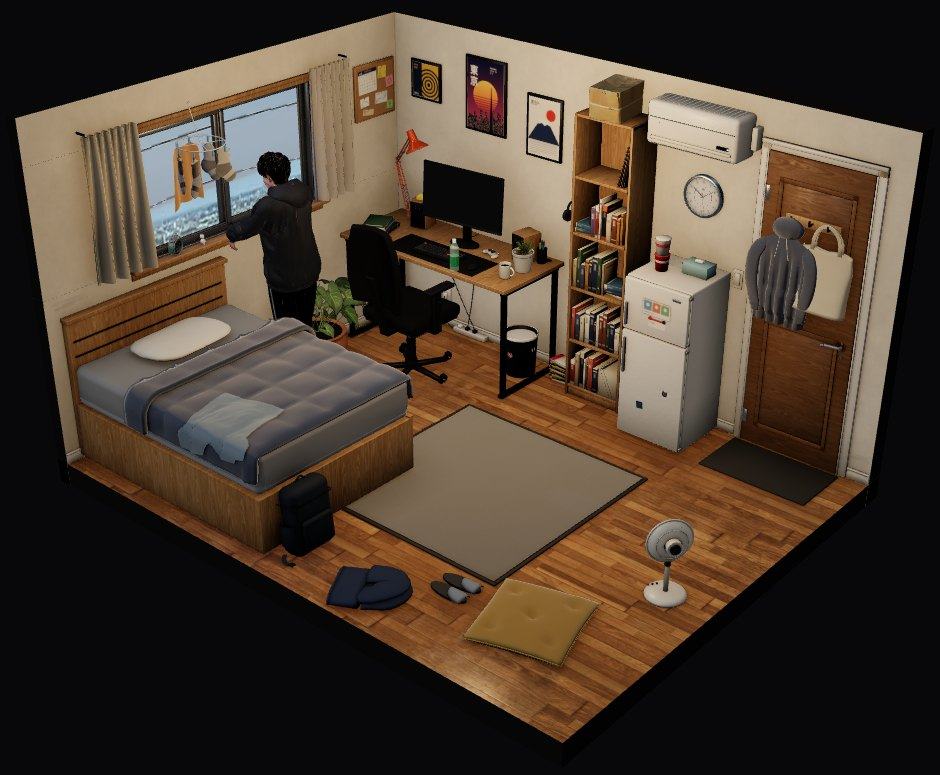
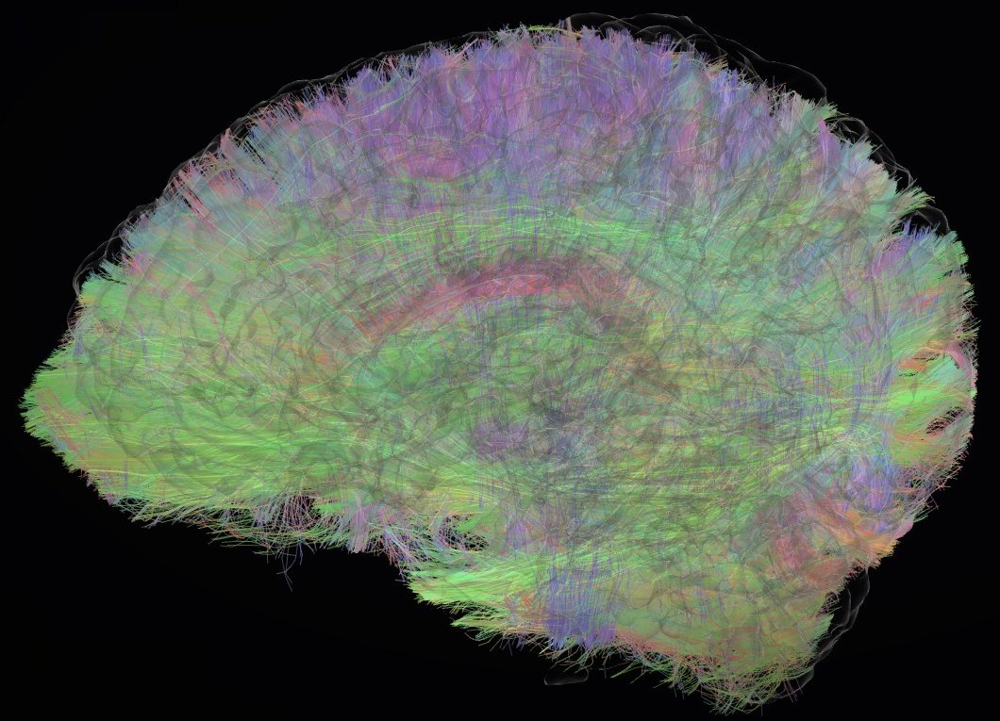
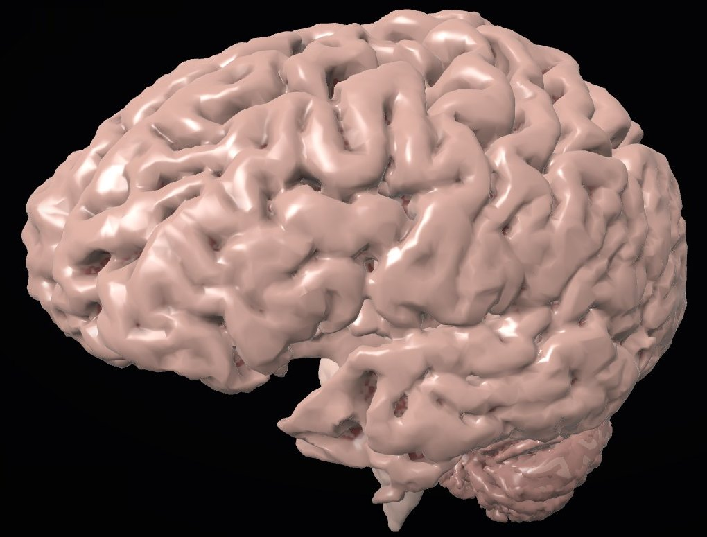
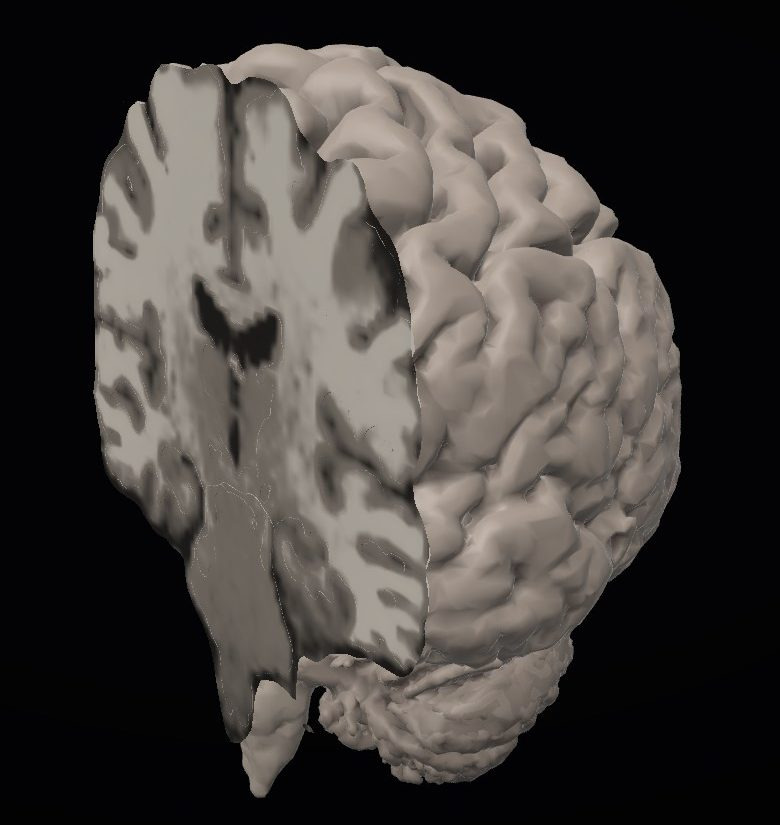
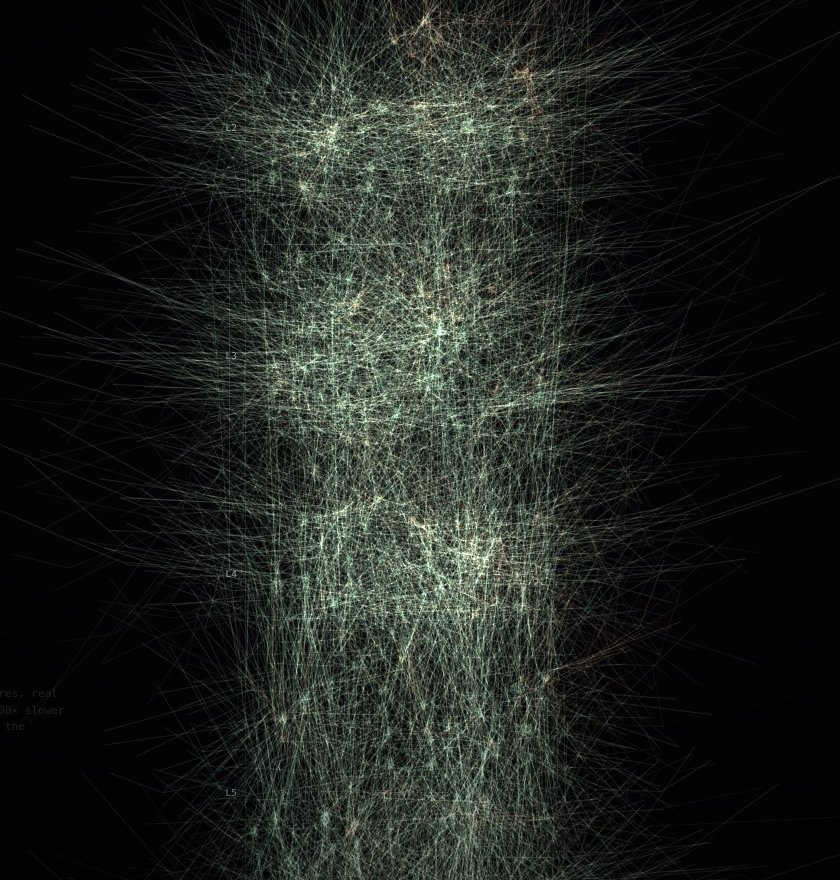
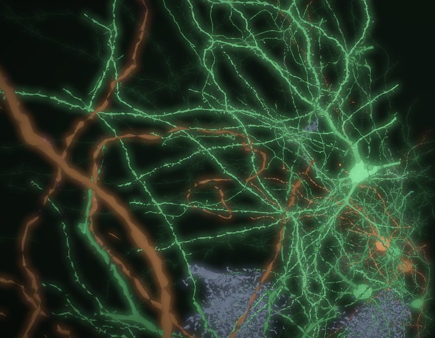
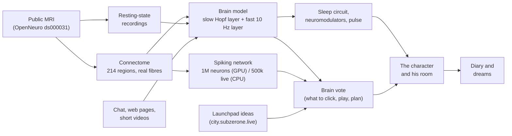

# SUB-01

**A brain rebuilt from real MRI scans, running 24/7, living the life of an invented guy in a tiny room in Tokyo.**

**[▶ Watch him live](https://subzerone.live)** · **[🧠 His brain](https://subzerone.live/brain)** ·
**[🌙 Dream diary](https://subzerone.live/diary)** · **[🏙 The city (launchpad)](https://city.subzerone.live)** ·
**[𝕏 @SUBZERONE01](https://x.com/SUBZERONE01)**

<p align="center">
  
</p>

Take one person's public MRI scans. Trace the real nerve-fibre bundles between 214 brain regions. Run a model of brain
activity on that wiring, all day, every day. Then let that model drive a character: when he falls asleep, what he
clicks on the internet, which song he plays, which chess move he makes, what he replays in his dreams, how fast his
simulated heart beats.

That is SUB-01. The wiring, the shape of the cortex and the resting-state recordings come from one open dataset (the
MyConnectome project, OpenNeuro [ds000031](https://openneuro.org/datasets/ds000031)). **It is a model, not a mind.** It
does not understand, feel or think, it is not alive and it is not conscious; "he reads" or "he sleeps" is shorthand for
what the simulation does. It is not the scanned person, and the character, his room and his life are fiction.

### In numbers

| | |
|---|---|
| 🧩 Brain regions, wired with real tractography | **214** |
| ⚡ Simulated spiking neurons | **1,000,000** on rented GPUs (scheduled) · **500,000** live on the server CPU, all day |
| 🌙 Sleep, from a published sleep–wake circuit | falls asleep ~**23:56**, wakes ~**07:54** Tokyo time, with REM replay |
| 🧪 Neuromodulators | dopamine, serotonin, noradrenaline, acetylcholine, mapped on real receptor densities |
| 🧠 Memory | 6/6 items recalled a simulated day later (one GPU validation run) |
| 📉 Honest negatives | 1M neurons did **not** learn Pong; consciousness test (PCI) 0.18, below the human 0.31 line |
| 🏙 Launchpad votes | an idea dropped in [the city](https://city.subzerone.live) gets his brain's build / pass answer in seconds, day and night |

Everything runs live on the site and locally in demo mode, see [Run it locally](#run-it-locally). The same brain answers
the SUBZERONE launchpad, see [The launchpad](#the-launchpad).

## What you see

| | |
|---|---|
|  |  |
| **The room** (`/`): his day in 3D on the Tokyo clock. He works at the desk, eats, uses his phone, looks out of the window and sleeps; the monitor and phone show the pages he is on. (Here at 14:00; the page on the monitor is a test fixture.) | **The window:** photographic Tokyo plates with real parallax, sky and weather that follow the hour (here 18:00). |
|  |  |
| He gets up from the desk and looks out of the window. | **His brain** (`/brain`): the real nerve-fibre bundles traced from the diffusion MRI. Chat messages travel along them as stimuli. |
|  |  |
| The same brain as a specimen: cortex, cerebellum and brainstem from his own T1 scan. Vessels and some nerves come from an atlas and are labelled as such. | Dissected: a coronal cut through the same brain, showing his own T1 scan (grey and white matter) on the cut face. |
|  |  |
| One continuous zoom: whole brain → a cortical column at true size, with layers L1–L6 measured in H01 … | … → real human neurons from the H01 electron-microscopy reconstruction, with simulated activity on them. None of these cells is from the scanned person. |

Also on the site: the **dream diary** (`/diary`), written each Tokyo morning from what was replayed in REM sleep; what
the model "sees" (`/world.html`, labelled "sees": images generated from its state); and `/about.html`, with every number
and credit. Diary lines and dream images are AI-generated and labelled as such.

## What it does

- **Sleeps.** A published sleep–wake circuit (Phillips & Robinson 2007) decides when the model is awake, in NREM or in
  REM. Undisturbed it falls asleep around 23:56 and wakes around 07:54 Tokyo time. Chat messages heard during the day
  are replayed during REM. ([docs/twin/sleep.md](docs/twin/sleep.md))
- **Reads the web.** A headless browser follows links, searches and reads pages on the open web, read-only: the only
  thing it types is a filtered query into a site's search box; it never posts, signs up, buys or connects a wallet, and
  a guard blocks unsafe sites. The brain model votes among the options on each page. What it reads becomes a stimulus
  and dream material.
- **Short videos and a dopamine model.** Phone time goes to short videos (YouTube Shorts, TikTok) through their official
  players; each new video gives a simulated, habituating dopamine-like burst. The fix (official YouTube Data API,
  TikTok's official player) is merged and is being verified on the live site (see [docs/HANDOFF.md](docs/HANDOFF.md)).
- **Chat and "teach him something".** Messages are filtered (no links, addresses or tickers), then turned into input to
  the brain networks their words relate to. A taught word is studied, replayed at night and tested the next day.
- **An AI reads and remembers for him; his brain model chooses.** A language model writes short notes on pages, proposes
  day plans for the brain model to vote on, and can write chat replies tagged "his reply (AI-written)". Capped at
  $2.00 per Tokyo day.
- **Spiking neurons.** One million simulated spiking neurons inside his wiring run on rented GPUs (scheduled, capped),
  and a 500,000-neuron network runs on the server CPU all day (`SUB01_SPIKING_LIVE_NEURONS`; 20,000 by default on a
  laptop). They vote in choices, learn from a dopamine signal, and take a daily memory test; every vote record names
  the network that answered. Also YouTube and chess at the desk, music picked by the brain vote, and food orders
  (simulated).
- **Votes on launchpad ideas.** The SUBZERONE launchpad ([city.subzerone.live](https://city.subzerone.live)) asks his
  brain about every idea dropped in the city; the answer is a build / pass verdict from the same vote as his clicks.
  See [The launchpad](#the-launchpad).

## How it works



| Stage | What | Where |
|---|---|---|
| MRI → connectome | tractography + Schaefer-200 / Harvard-Oxford atlas (214 regions); v2 with MRtrix3 + SIFT2 | `build_connectome.py`, `analysis/build_connectome_v2.py` |
| Brain model | slow Hopf layer fitted on half of the recordings, tested on the other half; fast delayed Stuart-Landau layer for the live display | `twin/hopf.py`, `brain_sim.py` |
| Spiking network | leaky integrate-and-fire populations per region, delays from fibre lengths, STDP × dopamine | `spiking/` |
| Sleep, body, chemistry | Phillips–Robinson circuit, neuromodulators, pulse | `sleep.py`, `twin/neurochem.py`, `twin/body.py` |
| Choices | the brain model votes among options from pages, videos, chess moves, tracks, day plans; the record names the network that answered | `brain_vote.py`, `life.py`, `browse.py` |
| Launchpad | a signed server-to-server call: idea → brain networks → the same vote; build when p(build) ≥ 0.5 | `launchpad_eval.py` |
| Character and room | three.js room, character, phone and monitor screens, window | `web/room.html`, `web/room/`, `room_build/` |
| Diary | REM replays → the morning's entry | `diary.py`, `web/diary.html` |

The full pipeline, the real-wiring analysis, sleep/chat/memory and the spiking network's settings are in
**[docs/TECHNICAL.md](docs/TECHNICAL.md)**.

## The launchpad

[**city.subzerone.live**](https://city.subzerone.live) is the SUBZERONE launchpad: a 3D Tokyo neighbourhood where anyone
can drop an idea for a coin. The launchpad server
([nocontentinhere4-art/subzerone-launchpad](https://github.com/nocontentinhere4-art/subzerone-launchpad)) asks this
brain about the idea, and his answer decides whether the site gets built and the coin launched on pump.fun. The room
page links to the city and shows its live card. This repository holds only the brain's side of that conversation,
`launchpad_eval.py`:

- `POST /api/launchpad/evaluate`, server-to-server, signed: HMAC-SHA256 over `<timestamp>.<body>` with
  `LAUNCHPAD_BRAIN_SECRET` (300 s skew). Without the secret the route answers 503: off.
- The idea's title and concept are routed to brain networks by the same word lexicon and rule table a chat message
  goes through. Two options enter the ordinary brain vote on a clone of the live brain: **build** (the idea's networks)
  and **pass** (a weak "keep doing what he is doing" drive, the same for every idea). The spiking network (the
  500,000-neuron live net, or the GPU net when it is on) races its striatal pools on the two labels and leans the vote.
- The verdict is the vote's build probability, not a dice roll: **build when p(build) ≥ 0.5**. The record keeps every
  option's simulated response (reward, attention, threat …), the sleep stage, the mood and which network answered.
- Always on: asleep he votes too, on a woken clone (awake rhythm and gain), so the cortex model answers as it would by
  day; every answer and ledger row carries the stage.
- Idempotent: the same `request_id` returns the stored record (`launchpad_evals.jsonl` in the data directory), never
  a second vote. The chosen option's stimulus reaches the live brain, so an idea he builds is also something he "heard".

What this is not: the model does not read or understand the idea. Words are routed by a hand-written table and the
vote is a rule on simulated activity; no language model is involved. Launching a coin is the launchpad's business and
happens outside this repository.

## Real, simulated, fiction

| | |
|---|---|
| **Real data from the scanned person** | nerve-fibre tractography (diffusion MRI), cortex, cerebellum and brainstem surfaces and the T1 cut, resting-state recordings (fMRI) |
| **Real data from other people (atlas / reference)** | brain vessels and some nerves (BodyParts3D, VENAT), cortical layer thicknesses and EM neurons (H01), neuron shapes (NeuroMorpho.Org), receptor densities |
| **Real, from the world** | the web pages he browses, the Tokyo street map (OpenStreetMap), the photographic window view |
| **Simulated** | all brain activity, sleep stages, neuromodulators and pulse, spiking neurons, learning and memory recall, tastes |
| **AI-generated (labelled)** | diary lines, dream and "eye" images, page notes, day plans, chat replies |
| **Fiction** | the character, his room, his day and his life; his food orders |

## Honest numbers

Each number comes from a file in this repository; negative results stay.

| Result | Number | Source |
|---|---|---|
| Wiring-only model vs recorded activity, held-out sessions | FC r ≈ 0.21 (randomised wiring 0.16–0.17; geometry nulls only borderline, p = 0.059) | [docs/real_wiring_report.md](docs/real_wiring_report.md) |
| Perturbational complexity (PCI) | 0.18 awake, 0.07 NREM, 0.17 REM, all below the 0.31 clinical cut-off | [docs/pci/README.md](docs/pci/README.md) |
| 1M spiking neurons playing Pong | **not learned**: 17.5 % vs 25 % for the no-plasticity control | [docs/spiking_report.md](docs/spiking_report.md) |
| 1M spiking neurons learning to choose | exam 1.00 vs 0.275 with learning removed (0.26 random) | [docs/spiking/choice.md](docs/spiking/choice.md) |
| Live decisions at 1M neurons | 0.45–0.69 correct vs 0.24–0.38 frozen twin (3 networks, small samples) | [docs/spiking/choice.md](docs/spiking/choice.md) |
| Reading memory on the GPU | 6/6 items recalled a simulated day later, one validation run | [docs/spiking/gpu_reading/](docs/spiking/gpu_reading/) |
| Room realism (visual QA scorecard, 2026-10-03) | 2.4 / 5 overall (was 1.9 before the soft-goods, hard-surface and window passes) | [docs/qa/scorecard.md](docs/qa/scorecard.md) |

## Run it locally

```bash
python3.12 -m venv .venv && . .venv/bin/activate
pip install -r requirements-server.txt        # the live server (requirements.txt is the MRI pipeline)
BROWSE=0 python live_server.py --demo         # http://localhost:8765 : room at /, brain at /brain, diary at /diary
python live_server.py --demo --time-scale 60 --start 23:55   # an accelerated night
SUB01_SPIKING_LIVE_NEURONS=500000 BROWSE=0 python live_server.py --demo   # the live site's CPU net size (default 20,000)
```

Tests:

```bash
pip install pytest
python -m pytest -q tests/                    # spiking tests skip without torch, browser tests without Chromium
BROWSE=0 python tests/smoke_demo.py           # starts the demo server, checks pages, /ws and the tick cost
python -m tests.visual.harness --out tests/visual/out   # room screenshots (needs Playwright + Chromium)
```

`--demo` uses fake inputs and keeps its state in `data/demo/` (or a temporary directory for the smoke test). Paid
services (image generation, language model, GPUs) are optional and off without their keys. Rebuilding the brain from
the raw MRI needs `requirements.txt` and `./fetch_data.sh` (~900 MB): see [docs/TECHNICAL.md](docs/TECHNICAL.md). The
launchpad route stays off without `LAUNCHPAD_BRAIN_SECRET`; [tests/test_launchpad_eval.py](tests/test_launchpad_eval.py)
exercises it with a test secret.

## Repository map

| Path | What |
|---|---|
| `live_server.py` | the server: brain loop, sleep, chat, life, browsing, APIs, `/ws` |
| `brain_sim.py`, `twin/` | the fast brain layer; the fitted slow layer, neurochemistry and body |
| `sleep.py`, `chat.py`, `diary.py` | sleep circuit and memory replay, chat filter, dream diary |
| `life.py`, `brain_vote.py`, `mind.py` | his needs and day, the brain vote, the AI notes and plans |
| `launchpad_eval.py`, `audience.py`, `lexicon.py` | the launchpad's signed vote on ideas; the viewers' vote in the room; the money / hype word lists every filter shares |
| `browse.py`, `browse_service.py`, `search_sources.py`, `short_videos.py` | the read-only browser and what it searches and watches |
| `spiking/` | the spiking network: model, plasticity, memory, GPU sessions, caps |
| `build_*.py`, `export_*.py`, `process_rest.py` | MRI pipeline: connectome, cortex, fibres, recordings |
| `analysis/` | offline analyses: real wiring, PCI, anatomy, neuron morphologies, benchmarks |
| `web/` | the pages: `room.html`, `index.html` (`/brain`), `diary.html`, `world.html`, `about.html`, and their assets |
| `room_build/` | the Blender and Node scripts that build the room, props and character clips |
| `tests/` | unit tests, the demo smoke test and the room's visual QA (`tests/visual/`) |
| `docs/` | reports, design notes, screenshots and the project's working docs |

## Documentation

- [docs/TECHNICAL.md](docs/TECHNICAL.md): pipeline, real wiring, resting state, sleep/chat/memory, spiking settings
- [docs/ROADMAP.md](docs/ROADMAP.md): milestones, decisions, known risks, launch checklist
- [docs/HANDOFF.md](docs/HANDOFF.md): how every runtime piece works today
- [docs/OPERATIONS.md](docs/OPERATIONS.md): costs, daily caps, health checks, monitoring
- [docs/real_wiring_report.md](docs/real_wiring_report.md): how much of the fit comes from the wiring
- [docs/spiking_report.md](docs/spiking_report.md) and [docs/spiking/](docs/spiking/): the spiking network, results and limits
- [docs/spiking/live_cpu.md](docs/spiking/live_cpu.md): the spiking network on the server CPU (`SUB01_SPIKING_LIVE_NEURONS`)
- [docs/pci/README.md](docs/pci/README.md): the perturbational complexity test
- [docs/twin/sleep.md](docs/twin/sleep.md), [docs/twin/neurochem.md](docs/twin/neurochem.md), [docs/twin/body.md](docs/twin/body.md): sleep, chemistry, body
- [docs/research/game_look.md](docs/research/game_look.md), [docs/research/real_brain_sources.md](docs/research/real_brain_sources.md): research notes
- [docs/qa/scorecard.md](docs/qa/scorecard.md), [docs/qa/defects.md](docs/qa/defects.md): the room's visual QA

## Credits and licences

- **MRI data:** the MyConnectome project, Poldrack RA et al. (2015), *Long-term neural and physiological phenotyping
  of a single human*, Nature Communications 6:8885. OpenNeuro ds000031, PDDL (public domain). With thanks to the project
  for making these data public.
- **Neurons:** NeuroMorpho.Org reconstructions (CC BY 4.0) and H01 (Shapson-Coe A, Januszewski M, Berger DR et al.,
  Science 2024, CC BY 4.0): [docs/spiking/morphology_credits.md](docs/spiking/morphology_credits.md).
- **Anatomy atlases:** BodyParts3D (CC BY 4.0), VENAT (CC BY 4.0), ICBM 152 (build time only):
  [web/anatomy/CREDITS.md](web/anatomy/CREDITS.md).
- **Room:** modelled for this project (CC0), Poly Haven and other CC0 assets, window plates and their licences:
  [web/room/CREDITS.md](web/room/CREDITS.md). The character was made for this project; the terms of its files are still
  to be confirmed.
- **Maps:** © OpenStreetMap contributors (ODbL). **Articles:** Wikipedia (CC BY-SA). **3D engine:** three.js (MIT).
- **Code:** no licence has been chosen yet. The full list is on [`web/about.html`](web/about.html).

All images in this README are our own screenshots of the pages, rendered in headless Chromium. A 60-second walk
through the room: [docs/qa/launch/launch_room.mp4](docs/qa/launch/launch_room.mp4).

## Disclaimer

SUB-01 is an art and science project: a model of large-scale brain activity, not a mind. It does not show the scanned
person's thoughts, memories or dreams, which cannot be read from MRI data, and it never depicts or speaks as that
person. The character and his life are fiction. Nothing in this project is medical or financial advice.
