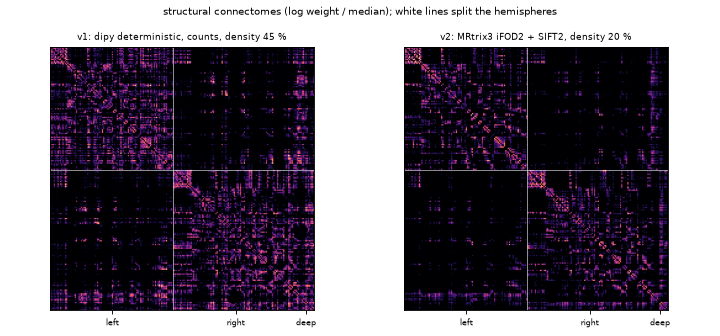
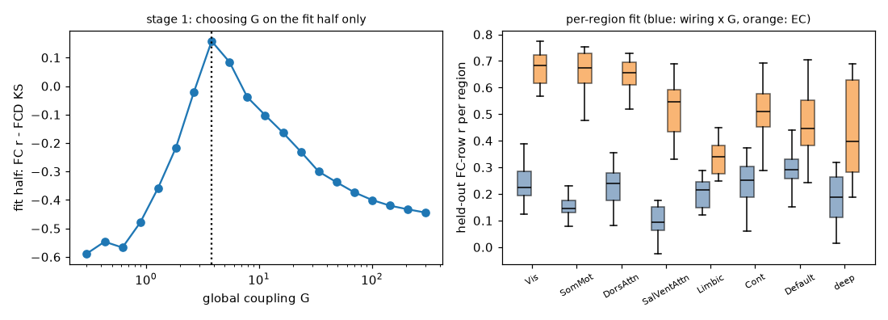
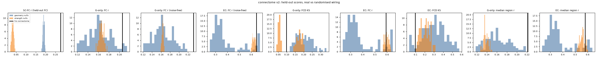
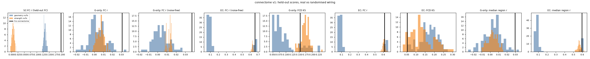

# Real wiring: does SUB-01's connectome do the work?

SUB-01 is a model of large-scale activity built on one real person's brain scans (MyConnectome, OpenNeuro ds000031,
public domain). It is not a mind, not conscious and not the person. This report asks one question and answers it
with numbers on data the model never saw: **does the activity the model generates come from this person's wiring,
and does it beat randomised wiring?**

## Short answer

All numbers are on the held-out half of his runs (sessions never used for fitting), connectome v2, final run
(corrected peak frequencies, coupling grid 0.3-300). p = (1 + randomised networks at least as good) / 101.

| | before (v1 connectome) | now (v2 connectome, Hopf slow layer) |
|---|---|---|
| Wiring vs recorded FC, no model (SC-FC r) | 0.197 | **0.276**, better than all 200 randomised networks (p = 0.01) |
| Model on the wiring alone (one fitted coupling): FC similarity, noise-free | 0.037 | **0.232**, better than all 100 geometry- (best 0.218) and all 100 strength-preserving (best 0.168) randomised brains, p = 0.01 / 0.01 |
| … same, measured on 20 simulated 10-minute runs | 0.031 (randomised wiring ≈ 0.00-0.01; all near zero) | **0.206**; strength nulls mean 0.166 (best 0.177), p = 0.01; geometry nulls mean 0.162 (best 0.215), **p = 0.059** |
| … per-region fit (median FC-row r) | 0.03 | 0.221, p = 0.01 / 0.01 |
| … FC dynamics (FCD KS, lower is better) | 0.154 | 0.098: better than all geometry nulls (p = 0.01) but **not** better than strength nulls (p = 0.47) |
| Effective connectivity fitted on the wiring (≈ 9,200 parameters for v2) | 0.616 (not wiring-specific either) | **0.591**, but randomised wiring fitted the same way does as well (p = 0.60 strength, 0.13 geometry) |

So, honestly:

1. **The new connectome carries more of the person's functional organisation** than the old one (SC-FC 0.28 vs
   0.20, both clearly above randomised wiring).
2. **With the new connectome, a model driven by the wiring alone now produces activity that resembles his recorded
   activity on unseen sessions** (r = 0.21-0.23 vs 0.03-0.04 with the old connectome). In the noise-free comparison it beats all 200
   randomised brains. In the finite-data comparison it beats every brain that keeps each region's total connection
   strength, but **not clearly the brains that keep the spatial layout** (p = 0.059). The margin is small: randomised
   brains already reach r ≈ 0.16-0.17, so the specific wiring adds about 0.04-0.07 of r on top of what each region's
   total strength, its own frequency, the spatial layout and one coupling give. Most of what the wiring explains is its
   geometry - a known result for human connectomes (Betzel & Bassett 2018 PNAS; Roberts et al. 2016 NeuroImage), and
   we reproduce it here rather than hide it.
3. **Fitting effective connectivity raises the similarity to r = 0.59, but that gain does not come from his wiring**:
   randomised networks fitted the same way reach the same score. It comes from fitting his recordings.
4. FC dynamics are not a robust win (they depend on the coupling grid and on the null family).
5. Nothing here is close to the test-retest ceiling (the two halves of his own recordings agree at r = 0.96).

The live model therefore now runs the **wiring-only slow layer by default** (a model on his connectome with one fitted
number generates the slow activity; most of its similarity to his recordings is also reached by randomised wiring), and
the page says what it is, how similar it is and what randomised wiring reaches. The recorded-fMRI replay,
which produced the old r = 0.40 without using the wiring at all, is now an explicit option ("replaying a real
recorded session").

## 1. What was wrong (reproduced)

The original `analysis/null_test.py` and `analysis/hopf_test.py` were not in the repository when this work was done;
both were reconstructed (now `analysis/null_test_recon.py` and `analysis/hopf_test_recon.py`, next to the originals,
which have since been added to `main`) and reproduce the reported numbers on the v1 connectome:

- v1 density 44.8 %, SC-FC r = 0.207 (log(1 + streamlines), all pairs, mean FC of the 131 runs).
- The deployed 10 Hz Stuart-Landau model alone: held-out FC r ≈ 0.02; the BOLD-band Hopf model on v1 with only the
  coupling fitted: FC r 0.03 on held-out sessions at the coupling that gives realistic dynamics (the analytic
  optimum at vanishing coupling, r ≈ 0.2, is a first-order copy of SC whose correlations are far too weak to measure).
- v1 inter-hemispheric connections: only 46 of the 85 homotopic (left-right mirror) region pairs have any streamline;
  the median weight over all 85 pairs is 1 streamline (20 among the 46 that have any). Pairs are matched by
  region name (85 of the 107 left regions have a same-named right region), not by geometric mirroring.

## 2. Connectome v2

Same DWI (ses-2015 acq-g79 dir-pe0, b = 0/1500/3000, 1.7 mm), same 214 regions (`out/labels_t1.nii.gz`) and the same
T1 → DWI transform (`out/t1_to_dwi.npy`, applied to the image header, no resampling).

Pipeline (MRtrix3 3.0.8 on a RunPod CPU pod, `analysis/pod/tract.sh`):

1. `dwigradcheck`: **the gradient table was mis-oriented for MRtrix** (mean streamline length 46.8 mm as given, 71.7 mm
   with x flipped in scanner space). The first run without this check produced 11 mm median streamlines and almost
   no inter-hemispheric connections; it was discarded.
2. `dwi2response dhollander`, multi-shell multi-tissue CSD, `mtnormalise`.
3. **ACT was tried and not used.** FSL and FreeSurfer are not available, so a 5-tissue image was built from the T1
   (`analysis/make_5tt.py`: bias-corrected 3-class mixture + the atlas' deep nuclei). In a 200k-streamline pilot it
   truncated streamlines (median 15 mm vs 71 mm without ACT, 4 % vs 17.5 % inter-hemispheric). v2 therefore uses
   iFOD2 seeded in the DWI white-matter mask (FOD cutoff 0.06, 10-250 mm) without anatomical constraints.
4. 12 independent chunks × 0.5 M = **6 M streamlines** (10 M were planned; the 2 h pod budget, partly spent on the
   failed runs above, allowed 6 M), SIFT2 weights (fibre bundle capacity), `tck2connectome` (radial search 4 mm).
5. Consistency threshold (`analysis/build_connectome_v2.py`): probabilistic tracking reaches 42 % of all region
   pairs in *every* chunk, so presence alone cannot thin it. Following consistency-based thresholding (Roberts et al.
   2017 NeuroImage), edges present in all chunks are ranked by the coefficient of variation of their SIFT2 weight
   across chunks and the most consistent ones are kept up to **20 % density**.

| | v1 (dipy, deterministic, counts) | v2 (MRtrix3 iFOD2 + SIFT2, consistency) |
|---|---|---|
| density | 44.8 % | 20.0 % |
| inter-hemispheric density | 27.1 % | 7.3 % |
| inter-hemispheric share of total weight | 19.9 % | 9.7 % |
| homotopic pairs with an edge (of 85) | 46 | 22 (42 present in every chunk, 69 in at least a quarter of them) |
| SC-FC r, all 131 runs (log(1 + w), all pairs) | 0.207 | **0.286** |
| SC-FC r, held-out half | 0.197 | **0.276** |
| SC-FC vs geometry-preserving nulls (all runs) | 0.207 vs max 0.158 of 500 (p 0.002, original analysis) | 0.286 vs max 0.208, p = 0.01 |
| SC-FC vs strength-preserving nulls (all runs) | p 0.01 (original analysis) | 0.286 vs max 0.044, p = 0.01 |

**The inter-hemispheric under-representation is not fixed.** Before thresholding, v2 reaches 69 of the 85 homotopic
pairs in at least a quarter of the chunks (42 in every chunk), but long callosal edges have erratic weights across chunks and are the first to
go under the consistency threshold. The model below therefore adds the homotopic pairs explicitly where it fits
effective connectivity (documented, not measured).

## 3. The slow layer (`twin/hopf.py`)

BOLD-band Hopf normal form (Deco, Kringelbach, Jirsa & Ritter 2017 Sci Rep), one node per region:

    dx_j/dt = (a_j - x_j^2 - y_j^2) x_j - w_j y_j + sum_k C_jk (x_k - x_j) + beta eta_xj
    dy_j/dt = (a_j - x_j^2 - y_j^2) y_j + w_j x_j + sum_k C_jk (y_k - y_j) + beta eta_yj

a = -0.02 (just below the bifurcation), beta = 0.02, w_j = 2π f_j with f_j each region's own BOLD peak frequency
(0.008-0.08 Hz, median 0.017 Hz) measured on the fit half (Welch spectra of runs with different TRs interpolated onto
one frequency grid before averaging). C = G × SC (SC = log(1 + w), symmetric, scaled to max 0.2).

- Fitting uses the exact linear (fluctuation) approximation (Ponce-Alvarez & Deco 2024, Sci Rep, "The Hopf whole-brain model and its linear approximation"): with z = x + iy the
  stationary covariance solves M P + P M^H + 2β² I = 0 and the lagged covariance is Re(e^{Mτ} P)/2; solved through
  one eigendecomposition per evaluation (tested against scipy's 2N × 2N Lyapunov solver to 1e-13). Simulated runs
  are sampled exactly at the TR (complex Ornstein-Uhlenbeck process). Its FC matches the nonlinear Euler-Maruyama
  simulation of the full Hopf model (mean FC r = 0.98 for his wiring, same held-out FC r), but its FCD does **not**
  match it closely (FCD KS between the two simulations 0.10 for the wiring-only model, 0.28 for the EC model; checked by
  the reviewer on the pre-fix run). Runs are then processed exactly like the recordings (detrend, 0.01-0.1 Hz
  Butterworth, z-score).
- **Stage 1, wiring only:** G is the only free parameter, chosen on the fit half by maximising simulated FC r - FCD KS
  (20 values, 0.3-300). FC r alone degenerates to G → 0.
- **Stage 2, effective connectivity** (Deco, Cruzat & Kringelbach 2019 PNAS; Gilson et al. 2016 PLoS Comput Biol):
  starting from G × SC, C_jk += 0.02 (FC_emp - FC_mod)_jk + 0.01 (COVτ_emp - COVτ_mod)_jk, τ = 2.32 s, only on the
  network's own edges plus the 85 homotopic pairs, C ≥ 0, until the fit-half FC r stops improving (≤ 300 steps).
  For v2 that is 9,242 directed parameters.

### Data split

131 QC-passed runs, **split by session**: sessions in chronological order alternate between the halves; multi-run
sessions are balanced by run count. Fit half: 65 runs from 46 sessions; held-out half: 66 runs from 48 sessions; no
session is in both. Everything that is fitted (peak frequencies, G, EC, the lagged covariance, which uses only the
TR = 1.16 s runs) uses the fit half only. The halves differ in acquisition mix (the fit half holds the 20 runs at
TR = 2.5 s, the held-out half the 16 runs at TR 1.49/1.25 s). Test-retest: fit-half mean FC vs held-out mean FC
r = 0.958 (the ceiling for any model of the mean FC).

### Held-out results, connectome v2

20 simulated 10-minute runs per network, scored against the 66 held-out runs.

| | FC r | FCD KS | median per-region r | mean FC (recorded 0.35) |
|---|---|---|---|---|
| wiring only (G = 3.82) | **0.206** (noise-free 0.232) | 0.098 | 0.221 | 0.58 |
| effective connectivity | **0.591** (noise-free 0.644) | 0.096 | 0.580 | 0.73 |

Both versions make the brain far too synchronised on average (mean FC 0.58-0.73 vs 0.35); FC r compares the pattern,
not the level. Per region (median FC-row r by network, figure right), the wiring-only model fits the default-mode
(0.29), control (0.25) and dorsal-attention (0.24) networks best and the salience/ventral-attention (0.09) and
somatomotor (0.14) networks worst; the effective-connectivity model fits the visual and somatomotor networks best
(0.68) and the limbic network (0.34) worst.

## 4. Randomised brains (nulls)

The identical pipeline (stage 1 and stage 2, same split, same seeds) was run on 100 geometry-preserving nulls
(degree and edge-length distribution kept, Betzel & Bassett 2018; `netneurotools.networks.match_length_degree_distribution`)
and 100 strength-preserving nulls (node strengths kept by simulated annealing; `strength_preserving_rand_sa`),
generated from his v2 weights (netneurotools, BSD-3). p = (1 + nulls at least as good) / 101.

| held-out metric (v2) | his wiring | geometry nulls: mean (best) | p | strength nulls: mean (best) | p |
|---|---|---|---|---|---|
| SC-FC r | 0.276 | 0.190 (0.199) | **0.010** | 0.032 (0.047) | **0.010** |
| wiring only: FC r, noise-free | 0.232 | 0.164 (0.218) | **0.010** | 0.163 (0.168) | **0.010** |
| wiring only: FC r, 20 simulated runs | 0.206 | 0.162 (0.215) | 0.059 | 0.166 (0.177) | **0.010** |
| wiring only: median region r | 0.221 | 0.162 (0.218) | **0.010** | 0.138 (0.150) | **0.010** |
| wiring only: FCD KS (lower is better) | 0.098 | 0.201 (0.118) | **0.010** | 0.120 (0.038) | 0.465 |
| EC: FC r, 20 simulated runs | 0.591 | 0.374 (0.648) | 0.129 | 0.596 (0.633) | 0.604 |
| EC: FC r, noise-free | 0.644 | 0.392 (0.674) | 0.119 | 0.623 (0.648) | 0.050 |
| EC: FCD KS | 0.096 | 0.299 (0.030) | 0.079 | 0.202 (0.103) | **0.010** |

Robustness and caveats:

- **Simulation noise.** Every network is scored on the same 20 simulated runs (same seed), which leaves a noise of
  about 0.006 (sd) on the held-out FC r. On the run before the frequency fix, re-scoring all 201 networks with a fresh
  seed moved the geometry p-value from 0.059 to 0.02. The noise-free (analytic) FC r has no such noise and gives
  p = 0.01 against both families. The geometry comparison is therefore **borderline** - "no clear advantage over the
  spatial layout", not "no advantage".
- **Most of the wiring-only FC r is not wiring-specific:** strength-preserving nulls, whose SC-FC r is only 0.03, reach
  0.166 and geometry nulls 0.162 (his wiring 0.206). Mean FC, each region's strength and frequency carry most of it.
- **FCD is not robust.** The fit-half objective has a narrow peak in G (at 3.82; neighbouring grid points are much
  worse). Before the peak-frequency fix the same G gave held-out FCD KS 0.038 and beat all nulls; after the fix it gives
  0.098, and strength-preserving nulls match the dynamics as well or better (p = 0.47). With G limited to 0.1-30 an
  earlier run picked G = 5.3 and strength nulls also matched better (p = 0.70). FC r is stable under all of these; FCD
  KS is not.
- **Peak frequencies (fixed).** The first version of `twin.hopf.peak_freqs` summed Welch spectra of runs with different
  TRs on the first run's frequency axis (16 % too high for the TR = 1.16 s runs, TR = 2.5 s runs dropped). It was found
  by the independent review, fixed (common frequency grid), and the final v2 and v1 runs above use the corrected
  frequencies (median 0.017 Hz instead of 0.0195 Hz). FC results barely moved (0.203 → 0.206); FCD did (above).
- **Geometry nulls want extreme coupling.** 64 of 100 choose the largest G in the grid (they always want a larger G than
  offered: 88/100 at the top of a 0.1-30 grid, 100/100 at the top of 0.01-3). The fit rule is applied identically to all
  networks, but their EC stage then starts from an extreme coupling and 80 of 100 stop at the 300-step limit, which is
  why their EC scores spread widely (mean 0.37). With G ≤ 30 they reached 0.60 and the EC p-value was 0.91: the EC
  comparison should be read as "no wiring advantage".
- For his wiring, 3,579 of the 9,242 EC mask edges end non-zero (the rest are clamped at zero).
- netneurotools reports "out of rewirable edges" for some geometry nulls: within some length bins all possible swaps
  were made, so those nulls stay closer to the original wiring; this makes the geometry test conservative.

### Connectome v1 (old) through the same pipeline

Same final settings (corrected frequencies, G 0.3-300), 100 + 100 nulls generated from the v1 weights.

| held-out metric (v1) | his wiring | geometry nulls: mean (best) | p | strength nulls: mean (best) | p |
|---|---|---|---|---|---|
| SC-FC r | 0.197 | 0.132 (0.144) | **0.010** | 0.006 (0.018) | **0.010** |
| wiring only: FC r, noise-free | 0.037 | 0.004 (0.027) | **0.010** | 0.012 (0.016) | **0.010** |
| wiring only: FC r, 20 simulated runs | 0.031 | 0.004 (0.036) | 0.020 | 0.007 (0.018) | **0.010** |
| wiring only: FCD KS | 0.154 | 0.095 (0.047) | 0.832 | 0.173 (0.135) | 0.119 |
| EC: FC r, 20 simulated runs | 0.616 | 0.195 (0.657) | 0.188 | 0.609 (0.653) | 0.327 |

With v1 the wiring-only model is "better than randomised" only in a technical sense: every network, his included,
sits near zero (r ≤ 0.04). The dense (45 %) v1 connectome cannot drive a pattern that resembles his FC; v2 can
(0.21-0.23). Geometry nulls of v1 also run to the top of the coupling grid (72 of 100).

## 5. What runs live

`brain_sim.Brain` keeps its public API (stimulate, step, run, state, set_rhythm, drive, group_idx). A
`twin.hopf.SlowLayer` (parameters in `twin/data/slow_layer.npz`, 60 KB) generates the spontaneous slow activity: the
linearised Hopf model is sampled exactly every 0.1 s of model time and its z-scored signal modulates the excitability
of the 10 Hz layer exactly where the replayed recording used to (1.6 per z-unit, scaled by sleep stage).

- Default: the **wiring-only** layer (v2 connectome × G). `SUB01_SLOW=ec` switches to the effective-connectivity layer.
- `live_server.py --replay-real-session` (or `REPLAY_REAL_SESSION=1`) replays a recorded session instead and switches
  the slow layer off. The old `--no-real-baseline` flag is accepted and ignored (it is now the default).
- The page says which background is running, e.g. "slow activity of a model on his wiring (one fitted
  coupling). Similarity of its co-activity pattern to his recorded activity on unseen sessions: r = 0.21; randomised
  wiring: r = 0.16-0.17".
- CPU (`analysis/bench_live.py`, 1 thread, process time per simulated second at live settings): slow layer alone
  **0.0005 core**; the existing 10 Hz layer, unchanged by this work, ~0.6-0.7 core on this shared sandbox. The new
  layer adds nothing measurable. The 10 Hz layer itself is the heavy part and is worth optimising for Railway
  (its delay gather is a 214 × 214 fancy index every millisecond).
- The live server does not need torch (only the offline fitting does); tested.

## 6. Compute and costs

All heavy compute ran on RunPod pods created by `analysis/runpod_job.py` (only CPU or RTX A5000, one pod at a time,
deleted on finish/error/60 min, 2 h total cap, never touching pods it did not create such as "BRAIN"); the
user's Mac was not used. Ledger: `data/analysis/costs.jsonl` (git-ignored).

| job | pod | minutes | USD | outcome |
|---|---|---|---|---|
| API / capacity probes (created and deleted at once) | CPU 2-4 vCPU | ~1.5 | 0.00 | — |
| tractography 1 (ACT, wrong gradients) | A5000 host, 9 vCPU | 30.2 | 0.14 | stopped by me: would overrun its time limit |
| tractography 2 (transient proxy error on upload) | CPU 32 | 0.6 | 0.01 | retried |
| tractography 3 (ACT, wrong gradients), 10 M | CPU 32 | 32.1 | 0.51 | done, discarded (11 mm streamlines) |
| tractography 4 (only 9 vCPU offered) | A5000 host | 1.6 | 0.01 | stopped, waited for 32 vCPU |
| tractography 5 (pilot crashed: no numpy in the image) | CPU 32 | 4.8 | 0.08 | found the gradient error |
| tractography 6 (final v2, 6 M) | CPU 32 | 19.2 | 0.31 | **done** |
| nulls + fits, v2 and v1 (G 0.01-3) | CPU 32 | 9.7 | 0.15 | done (first run; G grid too small for v2) |
| nulls + fits, v2 (G 0.1-30) | CPU 32 | 8.0 | 0.13 | done (robustness run) |
| **total** | | **107.7 min** | **$1.33** | |

The final runs (coupling grid 0.3-300, corrected peak frequencies, v2 and v1, 201 networks each) were done in this
sandbox with the same code (no pod budget left): about 35 minutes per connectome on 3 cores.

## 7. What is still not real

- The connectome is diffusion-MRI tractography: streamline-based estimates, undirected, without synapses, with known
  false positives and false negatives (especially long callosal and crossing fibres). No ACT, no distortion
  correction (no FSL), 6 M instead of 10 M streamlines, consistency threshold within one subject only.
- The slow layer is a phenomenological oscillator per region (Hopf normal form), not neurons; its signal is compared
  with BOLD directly (no hemodynamic model), with one bifurcation parameter for all regions.
- The fitted model is far too synchronised on average (mean FC 0.6-0.75 vs 0.35 recorded).
- The effective connectivity is fitted to his recordings; its advantage over the wiring-only model is not specific to
  his wiring.
- Most of what the wiring explains is its geometry: randomised brains with the same spatial layout come close, and
  even strength-preserving randomised brains reach r = 0.166 of his 0.206 in the wiring-only model.
- The held-out sessions are interleaved in time with the fit sessions (alternating sessions in chronological order; the 2022 sessions are only in
  the held-out half and WashU only in the fit half). This tests generalisation to unseen sessions, not to a later
  period; slow drifts shared by neighbouring sessions are not removed.
- The slow layer uses connectome v2; the fast 10 Hz layer in `brain_sim.Brain` still uses the old v1 connectome
  (`out/connectome.npz`) for its coupling and delays.
- FCD KS values are fragile (section 4); only FC r is robust to seed, grid and frequency choices.
- The slow layer's local parameters are not fitted per region: a and beta are shared by all regions; only the
  frequency is each region's own (its BOLD spectral peak).
- "Homotopic" pairs are matched by region name (85 pairs), which is an assumption, not a geometric mirror.
- The fast 10 Hz layer that the page displays is not fitted to anything; only its slow modulation is.
- Group-level priors (atlas, homotopic edges added to the EC mask) are assumptions, not measurements of this person.

## 8. Honest wording for the site

Short (status line on the page, `SlowLayer.status`):

> background: slow activity of a model on his wiring (one fitted coupling). Similarity of its co-activity pattern to
> his recorded activity on unseen sessions: r = 0.21; randomised wiring: r = 0.16-0.17

About text:

> SUB-01 runs on a map of one real person's brain wiring, reconstructed from his diffusion MRI. A model of slow brain
> activity is run on that wiring with a single fitted number, and its pattern of which regions move together is compared
> with his own recorded resting activity on scanning sessions the model never saw: r = 0.21 (his own sessions agree
> with each other at 0.96). Randomised wiring gets r = 0.16-0.17 in the same test, so his specific wiring adds only a
> small part: it is better than randomised brains that keep each region's total wiring, and only borderline better
> than randomised brains that keep the spatial layout of the connections. Most of what the wiring explains is where
> things are, not exactly which fibres connect them. It is a model of brain activity, not a mind; it is not conscious
> and it is not the person.

Do not write: "his wiring produces his activity", "generated by his wiring" without the randomised-wiring comparison, "a copy of his brain", "thinks", "feels", or the old r = 0.40
(that number came from replaying his recordings, not from the model).

## 9. Reproduce

    python analysis/make_5tt.py                                   # pod inputs (ACT tried, not used)
    python analysis/runpod_job.py --kind cpu --vcpu 32 --image mrtrix3/mrtrix3:3.0.8 --script analysis/pod/tract.sh \
        --upload <5tt.nii.gz> <labels.nii.gz> <mask_t1grid.nii.gz> --fetch connectome_v2_raw.tar.gz --tag tract --max-min 35
    python analysis/build_connectome_v2.py 0.2                     # -> out/connectome_v2.npz
    python analysis/real_wiring.py prep --conn out/connectome_v2.npz --tag v2 --nulls 0
    python analysis/real_wiring.py nulls --tag v2 --nulls 100 --workers 3
    python analysis/real_wiring.py run --tag v2 --workers 3
    python analysis/real_wiring.py report --tags v2 && python analysis/real_wiring.py export --tag v2
    python analysis/figures_real_wiring.py v2
    python -m pytest tests/test_real_wiring.py -q

## 10. Independent re-check (second model, own code)

On the run before the peak-frequency fix (its finding), an independent reviewer (a different model) re-derived the pieces below with its own code (own FC, FCD, KS, Lyapunov solution via scipy,
own exact OU sampler, fresh seeds) and the stored inputs/results:

- Maths: complex-form Lyapunov, lagged covariance and the C[j, k] = input from k to j convention agree with a
  nonlinear Euler-Maruyama simulation of an asymmetric network (lagged covariance r = 0.99, transposed convention 0.59);
  the exact OU sampler (noise covariance P - A P A^H) and the runtime `SlowLayer` reproduce the analytic FC (r = 0.997 /
  0.998) and unit variance. The EC rule is the Deco 2019 heuristic (FC and lagged-covariance terms, element-wise,
  C >= 0), not the full Gilson 2016 gradient.
- Leakage: the split is by session and disjoint (46 / 48 sessions, 65 / 66 runs); peak frequencies, G, EC target, lagged
  covariance and FCD target of the fit stage come from the fit half only (recomputed from the recordings, identical).
- Held-out numbers, his wiring, fresh seeds 101/202/303 (20 runs each): wiring-only FC r 0.220 / 0.216 / 0.217, FCD KS
  0.027 / 0.049 / 0.048 (reported 0.203 / 0.038); EC FC r 0.581 / 0.586 / 0.592, FCD KS 0.164 / 0.177 / 0.154
  (reported 0.590 / 0.154). Test-retest 0.958. P-values recomputed from the stored rows: identical to the tables.
- Connectome: density 0.200 (v2) vs 0.448 (v1), inter-hemispheric density 0.073 vs 0.271, homotopic pairs with an edge
  22 vs 46 of 85, SC-FC r 0.286 vs 0.207 (all runs), 0.276 vs 0.197 (held-out); 42 / 69 homotopic pairs present in all /
  a quarter of the chunks. SC-FC grows monotonically with density (0.242 at 5 %, 0.286 at 20 %, 0.292 unthresholded), so
  the 20 % threshold was not tuned to the recordings.
- Costs ledger sums to 107.7 min, USD 1.335.
