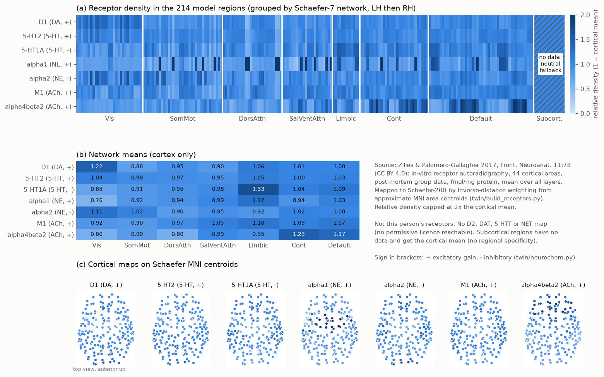

# Neurochemistry: neuromodulators and receptor-weighted gain (component: neurochem)

SUB-01 v2 is *a digital twin model of one real person's brain structure and recorded activity; not a mind, not
conscious, not the person*. This component adds four neuromodulator levels (dopamine DA, serotonin 5-HT,
noradrenaline NE, acetylcholine ACh) and turns them into a per-region gain vector for the whole-brain model. The
regional pattern comes from real receptor-density maps, but these are **group post-mortem data from other people,
not this person's receptors**. The dynamics that link market trades to "dopamine" and "noradrenaline" are simple
phenomenological rules chosen to make the model respond in a documented way. They are not a measurement of
anyone's brain chemistry.

Code: `twin/neurochem.py` (runtime; numpy only), `twin/build_receptors.py` (offline data build),
`twin/plot_receptors.py` (figure), `tests/test_neurochem.py` (20 tests).
Data: `twin/data/receptors_214.csv`, `twin/data/zilles2017_all_layers.csv`, sources and licences in
`twin/data/RECEPTORS_SOURCES.md`.

## 1. Receptor maps (data)

**Licence decision.** The obvious source, the Schaefer-parcellated PET maps of Hansen et al. 2022 (*Nat Neurosci*
25:1569; `netneurolab/hansen_receptors`), is **CC BY-NC-SA 4.0**. The same holds for the `neuromaps` repository and
its Beliveau/Nørgaard annotations. Most other neuromaps PET annotations state no licence. The project is public and
linked to a token, so it is treated as potentially commercial. **None of those data, or values derived from them,
are used or committed.** The one permissive (CC0) neuromodulator PET map, D2 raclopride (Malén et al. 2022
*NeuroImage* 255:119149), is hosted only on OSF, which is blocked here, and no GitHub mirror exists.

**What is used instead:** quantitative in-vitro receptor autoradiography from Zilles & Palomero-Gallagher 2017
(*Front. Neuroanat.* 11:78, **CC BY 4.0**), Supplementary Table 2. It gives mean density over all cortical layers
in **fmol/mg protein** for 15 receptors in 44 cortical areas, pooled over post-mortem brains. The file was taken
from the MIT-licensed mirror `AlGoulas/receptor_principles` (Goulas et al. 2021 *PNAS* 118:e2020574118), pinned
commit. It is parsed with a stdlib xlsx reader, and the parse was cross-checked cell-by-cell against Goulas'
independent `.npy` arrays (15 x 44 supragranular values, max difference 0).

Receptors used (7 of 15), with the sign of their effect on gain:

| receptor | system | coupling | sign | weight w | note |
|---|---|---|---|---|---|
| D1 | DA | Gs | + | 1.0 | D1 raises PFC excitability/gain (Seamans & Yang 2004 *Prog Neurobiol* 74:1) |
| 5-HT2 (ketanserin site, mostly 5-HT2A) | 5-HT | Gq | + | 0.5 | density-weighted 5-HT2A gain as in Deco et al. 2018 *Curr Biol* 28:3065 |
| 5-HT1A | 5-HT | Gi (GIRK) | - | 0.5 | inhibitory |
| alpha1 | NE | Gq | + | 1.0 | |
| alpha2 | NE | Gi | - | 0.5 | half weight, so NE is net gain-increasing (Aston-Jones & Cohen 2005) |
| M1 | ACh | Gq | + | 0.5 | |
| alpha4beta2 (nicotinic) | ACh | cation channel | + | 0.5 | |

Not available under a permissive licence: **D2, DAT, 5-HTT, NET** (see sources file). NE therefore uses
alpha1/alpha2 receptor density rather than NET (transporter) density as an innervation proxy.

**Mapping to the 214 model regions** (`twin/build_receptors.py`):
1. Each of the 44 areas gets an **approximate MNI centroid**, hand-set from standard cytoarchitectonic/Brodmann
   anatomy (Caspers et al. 2006 *NeuroImage* 33:430 for PFt/PFm/PGa/PGp). These are not from a probabilistic
   atlas; expect errors of roughly 10-15 mm. 37B/37L/37M are read as basal/lateral/medial parts of area 37.
2. Schaefer-200 (7 networks) MNI centroids come from ThomasYeoLab/CBIG (MIT, pinned commit). Their order equals
   `out/atlas_names.json[0:200]` exactly, which the build script checks.
3. Each parcel takes the inverse-distance-weighted mean (power 2) of its 3 nearest areas. |x| is used, so both
   hemispheres get the same values; the table pools hemispheres.
   174 parcels have an area within 20 mm (`source = autoradiography_idw`). **26 are further away**
   (`autoradiography_idw_extrapolated`: insula, medial occipital pole, some precuneus/somatomotor parcels).
4. **Subcortical (14 Harvard-Oxford nuclei): no data.** The CSV rows are blank. At runtime they get the cortical
   mean density, flagged `RECEPTOR_SOURCE = "fallback_cortical_mean"`. This means no regional specificity, and it
   is certainly wrong for striatum and thalamus, where D1/D2 and nicotinic densities are really much higher. It is a
   placeholder, not data.

**Normalisation.** `RECEPTORS[r] = min(raw / cortical_mean(raw), 2) / 2`, in 0..1, where 0.5 = cortical mean.
The cap at 2x the mean exists because the table lists alpha1 in area 6 as 1880 fmol/mg, 2.7x the next-highest area
(701, area 36). Uncapped, that one value would dominate the NE gain of about 12 premotor/FEF parcels. The raw value
is kept unchanged in the CSV. 5 alpha4beta2 parcels near areas 32/46 are also capped.

*Figure: (a) relative density in all 214 regions, grouped by network (subcortical hatched = fallback);
(b) network means; (c) cortical maps on MNI centroids, viewed from the top.*

## 2. Neuromodulator dynamics (`Neuromodulators`)

Each system m has a tonic level T_m and a phasic part P_m. The level is

    L_m = clip( T_m * (1 + P_m + [m = NE] * k_vol * vol), 0, 3 ),   1.0 = resting wake

Phasic effects scale with tonic, so a system that is nearly silent (NE in REM: locus coeruleus nearly silent,
Aston-Jones & Bloom 1981 *J Neurosci* 1:876) also responds weakly.

**Tonic levels follow the sleep engine.** `update(dt, sleep_levels)` relaxes T_m toward `sleep_levels[m]`
(missing key or None -> 1.0) with tau_tonic = 20 s: T += (target - T)(1 - e^(-dt/tau)). The expected pattern
(docs/twin_contracts.md) is REM: ACh high, NE/5-HT low; NREM: all lower. That is the reciprocal-interaction
picture (Hobson, McCarley & Wyzinski 1975 *Science* 189:55; Pace-Schott & Hobson 2002 *Nat Rev Neurosci* 3:591).
The numbers themselves come from the sleep engine, not from here.

**Pumps -> phasic DA as a reward-prediction error** (Rescorla & Wagner 1972; Schultz, Dayan & Montague 1997
*Science* 275:1593). For a buy of `usd` dollars:

    x = ln(1 + usd / 50)                  compressive size (model choice; 50 USD reference)
    delta = x - V ;  V <- V + alpha * delta      alpha = 0.3
    P_DA += k+ * delta  (delta > 0, k+ = 0.4)   or   k- * delta  (delta < 0, k- = 0.15)

The asymmetry k- < k+ reflects the limited range of dopamine firing below baseline (Bayer & Glimcher 2005 *Neuron*
47:129). The signal depends only on actual vs expected pump size, not on price level or absolute time. A second
learned quantity is the expected inter-pump interval: I <- I + 0.3 (interval - I). After at least 3 pumps, if no pump
has arrived by 1.5 x I, an **omission** negative RPE fires: delta = -V, P_DA += 0.06 delta, and V decays by a
factor (1 - alpha), i.e. extinction. It repeats every further I, with shrinking dips, the TD-style dip at the time
the reward was due (Schultz et al. 1997).

**Dumps and volatility -> NE** (LC-NE adaptive gain, Aston-Jones & Cohen 2005 *Annu Rev Neurosci* 28:403; NE as
"unexpected uncertainty", Yu & Dayan 2005 *Neuron* 46:681). For every trade, the signed size is s = +x (buy) or
-x (sell):

    sell:            P_NE += 0.25 * x
    any trade:       e = |s - mu| ;  mu <- mu + 0.2 (s - mu) ;  vol <- vol + 0.2 (e - vol) ;  P_NE += 0.1 * e
    NE level term:   + 0.12 * vol      (vol decays with tau_vol = 60 s)

**Decay.** P_DA: tau = 2 s (dopamine clearance takes sub-second to seconds and is slower in cortex than in
striatum; Garris & Wightman 1994 *J Neurosci* 14:442). P_NE: tau = 4 s. P_5HT, P_ACh: tau = 4 s (not driven by
trades in this version). Phasic parts are clipped to [-0.9, 2]. All parameters are in `DEFAULTS` and can be
overridden with `Neuromodulators(params=...)`. They are model choices, not fitted to data.

## 3. Region gain

    c_m,i   = sum over receptors r of system m:  sign_r * w_r * d_r,i / mean_i(d_r)
    drive_i = sum_m  s_m * (L_m - 1) * c_m,i          s = {DA 0.25, 5-HT 0.3, NE 0.4, ACh 0.25}
    g_i     = 1 + 0.5 * tanh(drive_i / 0.5)

This follows the neural-gain approach of whole-brain models, in which a neuromodulator scales regional gain in
proportion to receptor density (Deco et al. 2018 *Curr Biol* 28:3065, 5-HT2A; Kringelbach et al. 2020 *PNAS*
117:9566; Shine et al. 2018 *eLife* 7:e31130; Shine et al. 2021 *Nat Neurosci* 24:765). Properties (all tested):
- **exactly 1.0 everywhere at baseline levels**, since tanh(0) = 0, so the resting fit stays valid;
- bounded in [0.5, 1.5] and strictly inside for levels up to 3;
- a region with more of a receptor gets a larger change, with that receptor's sign;
- mean coupling per system: DA +1, NE +0.5, ACh +1, 5-HT 0. So 5-HT only redistributes gain across regions; its
  mean effect is zero by construction.

Contract usage: `brain.set_gain(nm.region_gain())` after `nm.update(dt, engine.params["modulators"])`.
For a model with n != 214, `region_gain(levels, n=n)` returns a uniform, non-specific gain.

## 4. Results (numbers from the code as committed)

Gain across the 214 regions for fixed levels (other systems at 1.0):

| levels | min | mean | max |
|---|---|---|---|
| resting wake (all 1.0) | 1.000 | 1.000 | 1.000 |
| DA 1.5 | 1.057 | 1.122 | 1.181 |
| NE 1.5 | 0.974 | 1.095 | 1.311 |
| NE 2.0 | 0.948 | 1.169 | 1.448 |
| ACh 1.5 | 1.082 | 1.122 | 1.184 |
| 5-HT 1.5 | 0.964 | 1.000 | 1.051 |
| REM-like (DA 1, 5-HT 0.2, NE 0.1, ACh 1.4) | 0.584 | 0.933 | 1.128 |
| NREM-like (DA 0.8, 5-HT 0.6, NE 0.5, ACh 0.4) | 0.603 | 0.737 | 0.838 |

Trade responses (fresh state, wake):
- 8 identical 200 USD pumps every 10 s: RPE 1.61, 1.13, 0.79, 0.55, 0.39, 0.27, 0.19, 0.13; phasic DA increment
  0.64 -> 0.05 (habituation). The first pump raises DA to 1.64 and mean gain to 1.19.
- Expected pump missing: dips at 15, 25 and 35 s after the last pump, with DA at 0.93, 0.95 and 0.97.
- A 5000 USD pump after that habituation: RPE 4.1, DA 2.64.
- One sell: NE 1.26 / 1.90 / 2.73 for 50 / 500 / 5000 USD.
- 20 alternating 2000 USD buys/sells: NE 1.59 at the end, versus 1.00 for 20 identical 20 USD buys.

Robustness: a non-finite trade size, time, level or sleep-engine value (NaN/inf/None from a bad feed) is ignored or
replaced by baseline, so it cannot enter the state or the gain; trade sizes are clipped at 1e9 USD. `t` in `on_trade`
must be on the same clock (seconds) as `dt` in `update`.

Cost: `update` about 3 us, `region_gain` about 9 us per call, well within the live-server budget.

## 5. What is not realistic

- **Not this person's receptors.** Group post-mortem autoradiography from other brains; nothing individual.
- **Coarse spatial mapping.** 44 areas become 200 parcels through hand-set approximate area centroids and
  inverse-distance weighting. 26 parcels are extrapolated from areas more than 20 mm away. The insula,
  occipital pole and much of the precuneus have no area of their own in the table.
- **Subcortex has no receptor data.** It gets the cortical mean, which underestimates the striatal dopamine and
  thalamic cholinergic receptor densities.
- **Missing maps:** no D2 (so no D1/D2 opponency), no transporters (DAT, 5-HTT, NET), no M2/M3, 5-HT1B/4/6, and no
  GABA/glutamate modulation.
- Receptor density is not receptor occupancy or effect. Signs and weights are a textbook simplification: Gq/Gs
  count as excitatory and Gi as inhibitory, though real effects depend on layer, cell type and presynaptic location
  (alpha2A in PFC, for example, can improve working-memory network firing).
- Market trades as "reward" and "threat" are a design metaphor. A prediction error over trade sizes is not a
  measured dopamine signal of this or any person. Time constants and gains were picked to be visible at the live
  page's time scale, not fitted.
- 5-HT and ACh have no phasic drive here; they only follow the sleep engine.
- There is no receptor desensitisation, no volume transmission, and no feedback from brain activity to the
  neuromodulator nuclei.
- Double counting: the sleep engine also changes `a`, coupling and noise, and the tonic neuromodulator levels follow
  the same circuit state. In the live server the two act on different terms of the model (the receptor-weighted gain
  on the sigmoid slope; the stage on excitability, adaptation, the thalamic gate, G and noise), so the effect of sleep is
  partly counted twice. The overlap was not separated or fitted.
- The Zilles table's own SD/CV columns are not internally consistent for many entries. We use only the "all
  layers" mean and cap one outlier (alpha1 in area 6).

## 6. Sources and licences

See `twin/data/RECEPTORS_SOURCES.md`. Summary: Zilles & Palomero-Gallagher 2017 (CC BY 4.0) via
AlGoulas/receptor_principles (MIT); Schaefer et al. 2018 centroids via ThomasYeoLab/CBIG (MIT).
`twin/data/receptors_214.csv` is an adaptation under CC BY 4.0 with attribution. Not used: hansen_receptors and
neuromaps (CC BY-NC-SA 4.0), and PET maps with no stated licence.

## References

- Aston-Jones G, Bloom FE (1981) *J Neurosci* 1:876-886.
- Aston-Jones G, Cohen JD (2005) *Annu Rev Neurosci* 28:403-450.
- Bayer HM, Glimcher PW (2005) *Neuron* 47:129-141.
- Caspers S et al. (2006) *NeuroImage* 33:430-448.
- Deco G, Cruzat J, Cabral J, et al. (2018) *Curr Biol* 28:3065-3074.
- Garris PA, Wightman RM (1994) *J Neurosci* 14:442-450.
- Goulas A, Changeux J-P, Wagstyl K, et al. (2021) *PNAS* 118:e2020574118.
- Hansen JY et al. (2022) *Nat Neurosci* 25:1569-1581 (not used: NC licence).
- Hobson JA, McCarley RW, Wyzinski PW (1975) *Science* 189:55-58.
- Kringelbach ML, Cruzat J, Cabral J, et al. (2020) *PNAS* 117:9566-9576.
- Malén T et al. (2022) *NeuroImage* 255:119149 (not used: unreachable).
- Markello RD et al. (2022) *Nat Methods* 19:1472-1479 (not used: NC licence).
- Pace-Schott EF, Hobson JA (2002) *Nat Rev Neurosci* 3:591-605.
- Rescorla RA, Wagner AR (1972) In: Black AH, Prokasy WF (eds) *Classical Conditioning II*, pp 64-99.
- Schaefer A et al. (2018) *Cereb Cortex* 28:3095-3114.
- Schultz W, Dayan P, Montague PR (1997) *Science* 275:1593-1599.
- Seamans JK, Yang CR (2004) *Prog Neurobiol* 74:1-58.
- Shine JM et al. (2018) *eLife* 7:e31130.
- Shine JM, Müller EJ, Munn B, et al. (2021) *Nat Neurosci* 24:765-776.
- Yu AJ, Dayan P (2005) *Neuron* 46:681-692.
- Zilles K, Palomero-Gallagher N (2017) *Front Neuroanat* 11:78 (CC BY 4.0).
