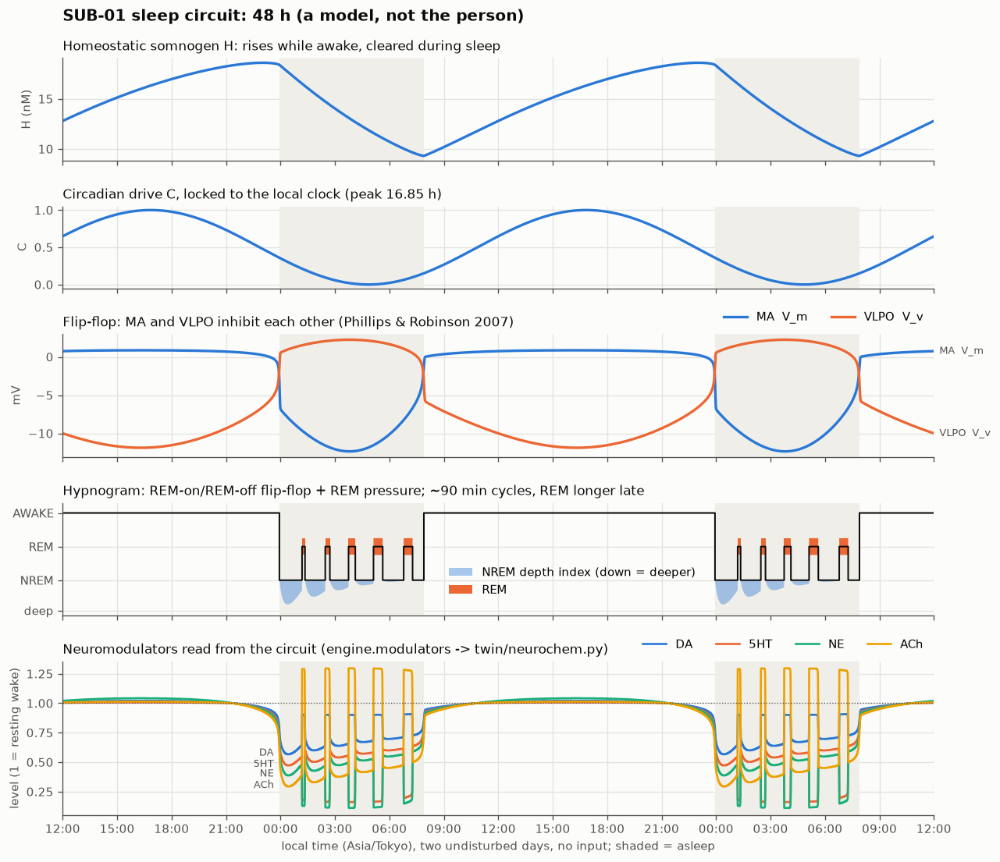

# Sleep: a sleep-wake circuit instead of a schedule (`sleep.py`)

SUB-01 is a model of brain activity built from one person's public MRI data; it is not a mind, it is
not conscious, and it is not the person. This section covers only the sleep engine, which decides when the
simulated brain is awake, in NREM or in REM sleep, and hands the whole-brain model its stage parameters and
neuromodulator levels. The old engine was a rule table: asleep 00:00-08:00, 90-minute cycles by the clock, and a
threshold on an arousal counter. The new one is a small published circuit model. Stages, cycles, wake-ups and
sleep debt all come out of its state variables.



*Figure: two undisturbed days (no messages, no trades), 12:00 day 1 to 12:00 day 3 on the local clock, stepped like
the live server at `--time-scale 120`. From the top: somnogen H; circadian drive C; the MA/VLPO flip-flop; the
hypnogram with the NREM depth index; the neuromodulator levels. Made by `python analysis/sleep_figure.py`.*

Ported to `main` from closed PR #4 (`feature/digital-twin`), where it was written and reviewed. The engine code is
the same as there; what changed is the wiring into the current `main` (section 6).

## 1. Sleep/wake: Phillips & Robinson (2007)

Source: A. J. K. Phillips & P. A. Robinson (2007), *A quantitative model of sleep-wake dynamics based on the
physiology of the brainstem ascending arousal system*, J Biol Rhythms 22(2):167-179.

The monoaminergic group (MA: locus coeruleus, dorsal raphe, tuberomammillary nucleus; mean potential V_m) and the
ventrolateral preoptic area (VLPO, V_v) inhibit each other. This mutual inhibition is the sleep-wake flip-flop.
The VLPO is also driven by a homeostatic somnogen H and a circadian drive C:

```
tau_m dV_m/dt = -V_m + nu_mv Q(V_v) + A_m + D_ext            (D_ext = arousal input, section 3)
tau_v dV_v/dt = -V_v + nu_vm Q(V_m) + nu_vc C(t) + nu_vh H
chi   dH/dt   = -H + mu Q(V_m)
Q(V) = Q_max / (1 + exp(-(V - theta) / sigma))
C(t) = 0.5 (1 + cos(2 pi (t_local - t_peak) / 24 h))
```

| parameter | value | unit | source |
|---|---|---|---|
| Q_max | 100 | s^-1 | PR2007 |
| theta | 10 | mV | PR2007 |
| sigma | 3 | mV | PR2007 |
| tau_m, tau_v | 10 | s | PR2007 |
| nu_vm | -1.9 | mV s | PR2007 |
| nu_mv | -1.9 | mV s | PR2007 |
| nu_vh | 0.19 | mV nM^-1 | PR2007 |
| nu_vc | -6.3 | mV | PR2007 |
| A_m (= nu_ma Q_a) | 1.0 | mV | PR2007 |
| chi | 10.8 | h | PR2007 |
| **mu** | **5.0** (PR2007: 3.6 = 10^-3 nM h) | nM s | **calibrated here** |
| **t_peak** (C = 1) | **16:51 local** | h | **calibrated here** |

I could not reach the paper itself from the sandbox (journal and model-repository hosts are blocked). The
published values were cross-checked against the MIT-licensed R package `sleepR`
(github.com/PabRod/sleepR, `philrob_default_parms`), which implements PR2007; the review re-read them there. So
the constants are "as in sleepR", not checked against the paper's own Table 1.

How long the published set sleeps depends on how "asleep" is defined (reviewer check, LSODA, steady 24 h cycle):
- `sleepR` calls the model asleep when H is falling (dH/dt < 0): **7.8 h per day** with the published values.
- Here the state must drive behaviour (stages, modulators, wake-ups), so "asleep" means the VLPO has overtaken
  the MA group (V_v > V_m): **6.4 h per day** with the published values (6.1 h with the 2 mV naming hysteresis).
  The V_v > V_m criterion is stricter, because V_m lingers near zero for a while after H starts to fall.

So the two calibrations below are needed only because of that choice of criterion; they are the only changes to
the published set:

- **mu = 5.0 nM s** (was 3.6). Raising somnogen production per unit of MA firing gives ~7.95 h of sleep per day by
  the V_v > V_m criterion (by the dH < 0 criterion the same value would give 8.9 h). Other single-scalar routes
  to ~7-8 h also work: A_m = 0.2 mV gives 7.3 h, nu_vh = 0.23 gives 7.3 h. We chose mu because it is one scalar.
- **Circadian phase.** C peaks at 16:51 local time, so its minimum is at 04:51, near the usual core-temperature
  minimum. With this phase the undisturbed model falls asleep at **23:56** and wakes at **07:54** on the
  Asia/Tokyo clock (`SUB01_TZ`). C is locked to the local clock: there is no light-driven pacemaker, no jet lag
  and no DST shift beyond what the zone itself does. Tokyo has no DST.

State naming: the model is *asleep* when V_v - V_m > +2 mV and *awake* when V_v - V_m < -2 mV. The 2 mV
hysteresis only affects naming. The switch itself takes about a minute.

## 2. NREM/REM: a REM-on/REM-off flip-flop with a slow REM pressure (our parameters)

PR2007 has no NREM/REM distinction. For that we add a second flip-flop that uses the same population equation
and the same sigmoid Q:

```
tau_r dV_on/dt  = -V_on  + nu_r Q(V_off) + A_on + G_p p + G_c (1 - C) - G_h (H - H_mid) - K_ma Q(V_m)
tau_r dV_off/dt = -V_off + nu_r Q(V_on)  + A_off
dp/dt = (1-w) [ (1-r)(1-p)/tau_up - r (p - p_min)/tau_dn(H) ] - w p / tau_pw
tau_dn(H) = tau_dn0 exp(g_tdn (H_mid - H))
r = 1/(1 + exp(-(V_on - V_off)/1 mV))  (REM-on share),   w = min(1, Q(V_m)/Q_wake)  (wake share)
```

Where the structure comes from:
- The anatomy of a pontine REM-on/REM-off mutual-inhibition switch follows Lu, Sherman, Devor & Saper (2006),
  Nature 441:589-594.
- Firing-rate flip-flop models of this kind are in Diniz Behn & Booth (2010), J Neurophysiol 103:1937-1953, and
  Rempe, Best & Terman (2010), J Math Biol 60:615-644.
- The idea that REM cycling comes from reciprocal interaction between cholinergic REM-on and aminergic REM-off
  cells is McCarley & Hobson (1975), Science 189:58-60. The MA -> REM-on inhibition (K_ma) is that link.
- The slow variable p makes the pair a relaxation oscillator. It is a "REM pressure" that builds during NREM, is
  used up during REM, and decays while awake, so there is no REM at sleep onset.

| parameter | value | unit | note |
|---|---|---|---|
| tau_r | 10 | s | as PR |
| nu_r | -1.9 | mV s | as PR's nu_vm |
| A_off | 2.0 | mV | makes the pair bistable for D_on in ~[1.48, 3.29] mV |
| A_on | 1.5 | mV | ours |
| G_p | 4.0 | mV | ours |
| K_ma | 2.0 | mV s | ours (no REM while MA fires) |
| G_c | 0.3 | mV | ours (circadian REM propensity; Dijk & Czeisler 1995, J Neurosci 15:3526) |
| G_h, H_mid | 0.08 mV nM^-1, 14 nM | | ours (high H favours NREM) |
| tau_up | 90 | min | ours |
| tau_dn0, g_tdn, p_min | 12 min, 0.2 nM^-1, -0.3 | | ours |
| tau_pw | 30 | min | ours |

**What emerges and what is imposed.**
- *Emergent from the circuit:* the switching itself; the ~75 min to the first REM (p starts near 0 after wake);
  the alternation of NREM and REM; wake-ups caused by input; earlier and longer sleep after sleep loss.
- *Set by our parameter choice (not fitted to data):* the ~90 min period, mainly tau_up and tau_dn.
- *Imposed couplings:* REM episodes lengthen across the night because tau_dn grows as H falls. Later NREM
  episodes shorten because the REM bias G_c (1-C) - G_h (H - H_mid) grows. REM is suppressed while MA fires.
- *Not a slow-wave model:* the **NREM depth index** is a readout. It is normalised H to the power 1.5 (slow-wave
  activity follows the homeostatic process: Borbely 1982, Hum Neurobiol 1:195; Achermann et al. 1993, Sleep
  16:329), made lighter as p approaches the REM gate, and passed through a 10 min lag. That puts deep NREM early
  in the night by construction.

We did not implement the McCarley & Massaquoi (1986) limit-cycle equations: their exact terms and parameters could
not be checked from here, and a Lotka-Volterra core is only neutrally stable.

## 3. Arousal: messages and trades as input to MA

This follows Fulcher, Phillips & Robinson (2008), Phys Rev E 78:051920, who model impulsive stimuli as input to
the MA group. Each accepted chat message adds 1 arousal unit. In deep NREM a message adds `1 - 0.4 depth` units
instead; this thalamic gating is a rule we kept. A trade of at least $5k adds `min(4.5, usd/5000)` units. Arousal
decays with a 5 min time constant; while asleep on an accelerated clock it decays at most 3x faster than real
time. The input is `D_ext = 1.8 mV x arousal`, applied to V_m. Waking up is the flip-flop switching. A wake-up
counts as *natural* when arousal is below 0.3; otherwise the cause is written to the night file ("5 messages",
"a large trade ($20,000)").

Messages needed to wake it, sent 20 s apart (undisturbed night):

| time | 00:20 | 01:00 | 02:00 | 03:00 | 04:30 | 06:00 | 07:15 |
|---|---|---|---|---|---|---|---|
| messages | 2 | 2 | 3 | 4 | 3 | 2 | 1 |

In this model it is hardest to wake near the circadian minimum. The C term dominates the VLPO drive. In human
data, arousal thresholds are highest in early-night slow-wave sleep. The depth gating only partly corrects this;
see the limitations. Once the input fades it falls asleep again, after about 15-18 min for a 6-message burst.

## 4. Sleep debt = excess H

`debt` (hours) = max(0, H - H_ref(clock time)) / (mu Q_wake / chi). Here H_ref is the model's own undisturbed
24 h cycle, computed once at start-up and cached. The divisor, 1.97 nM, is the H gained by one hour awake instead
of asleep. Setting `engine.debt = x` sets H accordingly. The debt therefore behaves the way H does:

- **Lost sleep and wake-ups raise it.** Four wake-ups of 15-18 min at 01:30, 03:00, 04:30 and 06:00 leave
  **1.0 h** of debt at 10:00, against 0.0 h for an undisturbed night. It also sleeps in until 08:48.
- **Sleep repays it.** The excess decays with chi = 10.8 h, and faster when the model sleeps while the reference
  is awake.
- **High debt means earlier sleep.** Debt set to 6 h at 20:00 gives sleep at 21:43 and waking at 08:23; debt is
  0.4 h the next noon.
- **Total sleep deprivation:** one message every 3 min from 22:00 to 08:30. It never sleeps and debt reaches
  **17 h** at 08:30. Being kept awake by input makes MA fire about 2-3x above resting wake, so H rises faster than
  in ordinary wake: one hour kept awake costs more than one hour. When the input stops it takes a recovery nap
  (08:31-12:54). The next night runs **22:41-08:12** (9.5 h, against the usual 8), and debt is 0.2 h the next
  noon. Phillips & Robinson (2008), J Theor Biol 255:413, analyse sleep deprivation and recovery in this model
  family; we only reproduce the qualitative pattern, earlier and longer recovery sleep.
- **Debt makes the waking brain less reactive and noisier.** Unchanged: `tired = min(1, debt/4)`, awake gain
  x (1 - 0.5 tired), noise x (1 + tired).

`pressure()` returns H scaled to the rested cycle: 0 after a full night, 1 at the usual bedtime. `life.py` uses it.

## 5. Neuromodulators (`engine.modulators`)

Tonic levels are read from the circuit state. The inputs are m = Q(V_m)/Q_wake (MA firing relative to resting
wake), r = REM-on share, and the NREM depth index. The levels blend four anchor sets:
NREM_light <-> NREM_deep by depth, then <-> REM by r, then <-> WAKE by min(1, m). When m > 1 (aroused), each level
gets an extra per unit of extra MA firing.

| level (1.0 = resting wake) | DA | 5-HT | NE | ACh |
|---|---|---|---|---|
| wake anchor | 1.0 | 1.0 | 1.0 | 1.0 |
| NREM light / deep anchors | 0.7 / 0.5 | 0.6 / 0.4 | 0.55 / 0.3 | 0.45 / 0.2 |
| REM anchor | 0.9 | 0.15 | 0.1 | 1.3 |
| aroused, per unit m above 1 | +0.3 | +0.1 | +0.6 | +0.2 |
| **measured means, undisturbed day: AWAKE** | 1.00 | 0.99 | 1.01 | 0.99 |
| **NREM (all)** | 0.66 | 0.56 | 0.50 | 0.41 |
| **NREM depth > 0.6** | 0.58 | 0.48 | 0.40 | 0.31 |
| **REM** | 0.90 | 0.19 | 0.14 | 1.27 |

Only the ordering comes from recordings:
- LC (NE) and DR (5-HT) firing: wake > NREM > REM, which is near silent (Aston-Jones & Bloom 1981, J Neurosci
  1:876; McGinty & Harper 1976, Brain Res 101:569).
- Cortical ACh: wake ≈ REM > NREM (Marrosu et al. 1995, Brain Res 671:329).
- VTA DA burst firing in REM (Dahan et al. 2007, Neuropsychopharmacology 32:1232).

The numbers themselves are ours and were not fitted. `live_server.py` passes these levels to
`twin/neurochem.py` every tick as its `sleep_levels` (`self.neuro.update(TICK, self.engine.modulators)`). They
replace the fixed per-stage table `STAGE_MOD` that `live_server.py` had before the port, so the tonic levels now
move continuously with NREM depth, the REM switch and arousal (NE rises above 1 when messages keep it awake).

## 6. Engine, integration and interface

- **Integration.** `update(t, dt_real)` integrates in substeps of at most 5 s, or at most 10 s when catching up
  more than 2 h, capped at 13000 substeps (36 h). The scheme is exponential Euler in Gauss-Seidel order, so even a large
  step relaxes onto a flip-flop branch instead of oscillating between branches. H and p use exact exponential
  updates.
- **Transitions.** Sleep, wake and REM transitions are found at the substep where they happen, and timeline
  stamps use that time.
- **Cost.** Measured 0.1 ms per call at `--time-scale 3600` (180 s of sim time per 50 ms tick) and 0.008 ms per
  call at real time. A 20 h catch-up takes about 20 ms (36 h: 30 ms), and its hypnogram agrees with stepping in
  1-minute ticks to within about 3 min per transition (30 s substeps were tried first and dropped a REM episode).
  A gap of more than 36 h (server off for days) restarts the model on the rested cycle, and the debt decays by
  exp(-gap/chi).
- **Unchanged public interface.**
  - `params` keeps the keys `f_hz, coupling, noise, a, gain`. The AWAKE/NREM_LIGHT/NREM_DEEP/REM tables are
    chosen from the circuit stage; NREM is interpolated by the depth index. Parameters still glide (30 s sim
    time constant, never faster than 1 s real time).
  - Also unchanged: `stimulus(t, kind, usd) -> gain`, and `update` returning `sleep`, `wake` (with `natural` and
    the cause text) and `replay` events.
  - Night files keep timeline, wake-ups with cause, replays and `sleep_debt` start/end. A natural wake before
    05:00 is written as a "spontaneous (no input)" wake-up and does not close the night.
  - Also unchanged: `to_dict/from_dict`, `Store`, `Memory`, `Clock`, `night_date`.
- **New.**
  - `status()` adds `H, C, V_m, V_v, V_on, V_off, rem_p, pressure, cycle, modulators`.
  - `engine.modulators` and `Reference`.
  - `TZ`/`TZ_NAME`. `ROME` is kept as an alias of `TZ` so the existing imports keep working.
  - Night files store the real zone name (old night files keep whatever they were written with). The leftover
    "Europe/Rome" wording in `sleep.py`, `live_server.py` and `README.md` was fixed.
- **Consumers, unchanged.** `diary.py` keys entries on `night["date"]` and closes them once `last_night` has a
  sleep onset (the night closes at the natural morning wake-up, ~07:54 instead of 08:00); `life.py` reads `stage` and
  `pressure()` (same 0 -> 1 range over the waking day); `web/index.html`, `web/room.html` and `web/diary.html` read
  `stage, clock, tz, gain, debt, woken_tonight` and the night records, all kept. `pressure(t)` still takes `t` but
  reads the current H (the old engine extrapolated from the time awake).
- **Old state files.** An old `state.json` without circuit fields still loads. The circuit starts on the rested
  cycle at the saved time, the saved debt is turned into H, and both flip-flops are relaxed onto the saved stage.
  `tests/data/state_rule_engine_{asleep,awake}.json` were written by the rule engine on `main` before the port and
  are loaded, run through a night and saved again in the tests.

## 7. Results (undisturbed days, `analysis/sleep_figure.py`; checked in `tests/test_sleep.py`)

- Sleep **23:56-07:54, 7.96 h**, one natural wake-up in the morning, no daytime naps. Over 48 h both nights are the
  same to within a minute per REM episode (the circuit sits on its daily attractor).
- Episodes (minutes): N75 R10 N67 R15 N62 R22 N60 R30 N70 R29 N36. That is **5 NREM-REM cycles** of 82-99 min
  (NREM + REM; REM onsets are 77-100 min apart), with the **first REM after 75 min**.
- **REM share 22.4 %.** REM episodes grow from 10 to 30 min across the night.
- Deepest NREM (depth index 0.8) is in the first cycle. Late-night NREM is light.
- `python -m pytest tests/test_sleep.py -q`: 29 tests, about 13 s. They cover the 24 h hypnogram, the **48 h
  hypnogram** at the `--time-scale 120` cadence (onset ~00:00 and wake ~08:00 Tokyo, 4-6 cycles, REM longer late,
  both nights alike, nights closed with their own dates), an independent LSODA check of the PR2007 equations,
  step-size invariance, modulators per stage and their path through `twin/neurochem.py`, circuit status,
  loading state files written by the old rule engine, cost, sleep deprivation, and all earlier behaviours:
  accelerated-clock cycling, smooth transitions, wake by messages or a large trade, no wake from small trades,
  debt, replay, night files and persistence.

## 8. What is not realistic

- **It is a mean-field sketch.** Two to four populations stand in for the whole sleep-regulating network. There
  are no orexin neurons, no adenosine receptor pharmacology and no thalamocortical slow oscillations.
- **Nothing is fitted to this person.** This component uses no sleep recordings of the person. Sleep timing,
  duration and cycle structure are generic, young-adult-like calibrations.
- **The REM circuit parameters are ours.** They were tuned by hand so that the numbers above come out. The REM
  lengthening across the night is imposed through tau_dn(H) and the REM bias. It is not derived from data.
- **The NREM depth index is a readout of H, not simulated slow waves.** It is deterministic: without input every
  night is identical. There are no spontaneous brief awakenings, no N1/N2/N3 split beyond the continuous depth
  index, and no REM rebound after REM deprivation.
- **The circadian drive is a fixed cosine locked to the clock.** There is no light input, no phase shifting and
  no jet lag.
- **Arousal thresholds peak near the circadian minimum (03:00-04:30).** Human thresholds peak in early-night
  slow-wave sleep. The messages-to-wake numbers are a design choice (G_arousal = 1.8 mV per unit). They are not
  measured.
- **The debt read-out in hours is exact only for ordinary wake.** Being kept awake by constant input costs more
  than one "hour" per hour. The page's debt bar is capped at 4 h.
- **The neuromodulator levels are ordinal anchors.** They are not concentrations.

## Data and licences

- No subject data is used by this component. Parameters come from the cited papers. The PR2007 values were
  cross-checked in `sleepR` (MIT licence); no code was copied from it.
- Figure and code are part of this repository.
